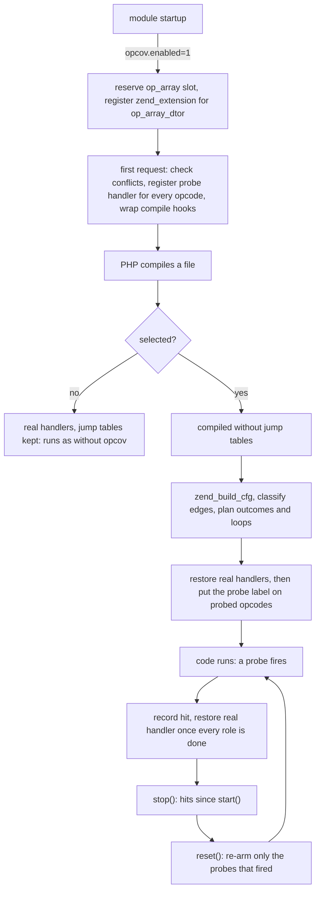
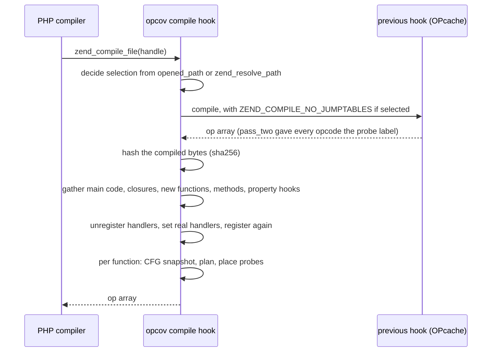
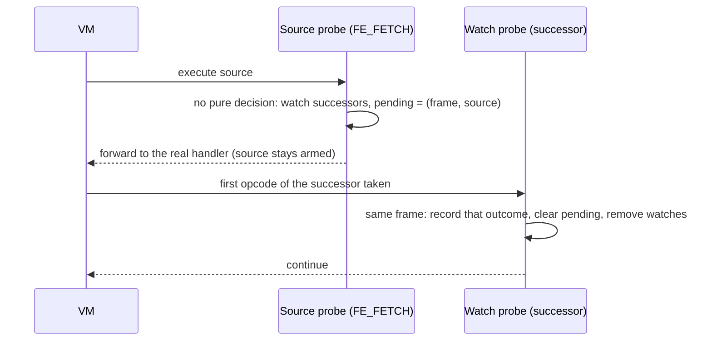
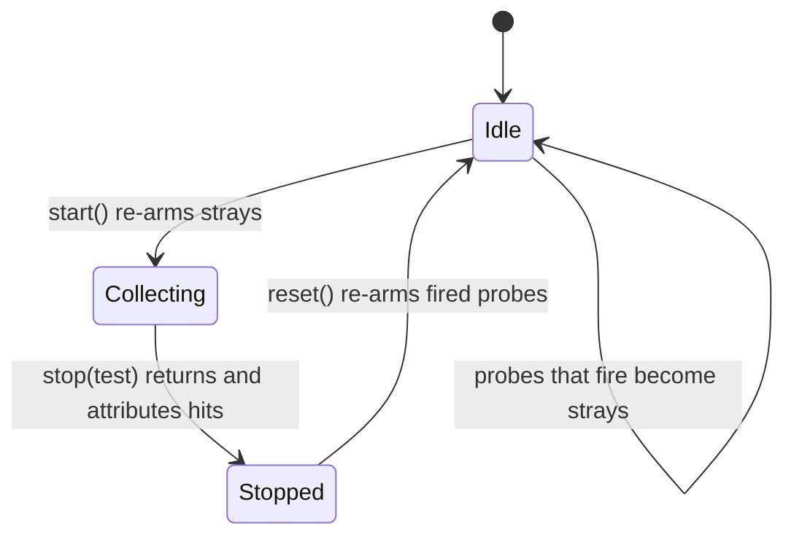

# How opcov works

opcov is a Zend extension written in Rust (`crates/opcov-ext`, on the bindings
of `crates/opcov-sys`). It measures code without rewriting it: it marks chosen
opcodes with a **probe**, a handler that records what happened and then puts
the opcode's real handler back. A line that has been seen runs at full speed
again until the next `reset()`. This is turbocov's mechanism, extended to
branch outcomes and loops. What the outcomes mean is in
[branch-semantics.md](branch-semantics.md); the binding choice and every engine
symbol used are in [ADR 0001](adr/0001-bindings.md); the outcome design and its
measurements are in [ADR 0002](adr/0002-outcome-probes.md).

## Startup

At module startup opcov registers its INI settings and, only when
`opcov.enabled=1`, reserves an `op_array.reserved` slot
(`zend_get_resource_handle`) and registers a `zend_extension` whose only hook is
`op_array_dtor`. With `opcov.enabled=0` it does nothing else.

At the first request (not at module startup) opcov:

1. claims the current thread as the owner of the probes (ZTS, see
   [Limits](#limits));
2. reads the selection settings ([configuration.md](configuration.md)) and
   checks for conflicting setups (OPcache JIT, file cache, preload, optimizer,
   Xdebug coverage, PCOV); with a conflict it installs nothing and refuses
   collection ([troubleshooting.md](troubleshooting.md));
3. saves the user opcode handlers other extensions registered and registers
   its own probe callback for every opcode except `ZEND_USER_OPCODE`;
4. computes the **probe label** (below);
5. wraps `zend_compile_file`, `zend_compile_string` and
   `zend_throw_exception_hook`.

Hooking at the first request rather than at startup means opcov wraps the
compile hooks of extensions that started before it, such as OPcache.

## The probe label

While a user handler is registered for an opcode, the VM assigns that opcode
the handler of `ZEND_USER_OPCODE`, which calls the user handler. opcov asks
`zend_vm_set_opcode_handler()` for the handler of a dummy `NOP` while its
handlers are registered: the address it gets back is the probe label. Writing
the label into any opcode's `handler` field makes that opcode call opcov's
callback the next time it runs; writing the saved real handler back removes
the probe. Probing and unprobing are single pointer writes.

The callback returns `ZEND_USER_OPCODE_CONTINUE` once it has restored the real
handler, so the VM re-dispatches the same opcode with it. While the probe must
stay (a branch source still waiting for an outcome), it forwards to the
previously registered user handler, or returns `ZEND_USER_OPCODE_DISPATCH` so
the real handler runs this once.

The engine self-test (`tests/phpt/engine/selftest.phpt`) proves the trick on
the HYBRID, CALL and TAILCALL VMs.

## Compiling a file

- **Selection** is decided once per resolved file name and cached for the
  process. An unselected file is tagged "no probes" in the reserved slot and
  keeps its real handlers and jump tables: it runs exactly as without opcov.
- **Jump tables.** Selected files are compiled with
  `ZEND_COMPILE_NO_JUMPTABLES`, so a `switch` becomes comparisons and jumps that
  probes can see ([configuration.md](configuration.md#jump-tables)). The
  decision is needed before compilation, hence the path resolution.
- **Real handlers.** `pass_two()` gives every opcode of a newly compiled op
  array the probe label, because opcov's handlers are registered. After
  compilation opcov unregisters them, calls `zend_vm_set_opcode_handler()` on
  every opcode of the new op arrays to get the real handlers, and registers
  again.
- **CFG snapshot.** For each function, opcov runs the engine's own
  `zend_build_cfg`, `zend_cfg_build_predecessors`,
  `zend_cfg_compute_dominators_tree` and `zend_cfg_identify_loops` in a
  temporary arena, copies the blocks, successors and loop headers into the
  owned model of `opcov-core` (`opcov_core::cfg::Function`) and frees the arena.
  The engine's CFG already understands every jump opcode, `try`/`catch`/
  `finally`, generators and unreachable blocks. A function whose snapshot
  fails turns collection off with `snapshot-failed`.
- **Plan.** `opcov_core::cfg::Plan` classifies every edge, numbers the
  outcomes (`o0`, `o1`, ... by site and successor) and loops (`l0`, ... by
  header), in one place shared by the extension, the report and
  `opcov-syntax`.
- **Probes** are placed: the label is written into each probed opcode.

`eval()`'d code goes through `zend_compile_string` the same way and is measured
when the file that called `eval()` is selected.

## Probe roles

One probe slot per probed opcode carries a set of roles; the slot keeps the
label while any role is armed:

| Role | Placed on | Job |
|---|---|---|
| `Line` | the first opcode of each line per block entry | record the line, then disarm |
| `Source` | a branching opcode | decide or watch its outcome; stays armed until every outcome was seen since the last reset |
| `Watch` | the first opcode of a successor block, temporarily | resolve the outcome of a pending source |
| `LoopEntry` | the jump that enters a `for`/`while` from outside | start a loop activation |
| `FinallyEntry` | the first opcode of a `finally` block | detect entry by exception |

`\opcov\get_debug_info($file)` lists every probe with its armed roles.

### Line probes

A line probe fires once, records the line and restores the handler. Which
opcodes are lines follows PCOV's rules
([configuration.md](configuration.md#executable-lines)); `new` and its
constructor call count once, and a line that only consumes the value of a
multi-line expression gets no probe
([branch-semantics.md](branch-semantics.md#multi-line-expressions)).

### Branch outcomes

A source learns the outcome one of two ways:

- **Evaluate in the probe.** For opcodes whose decision is a pure function of
  an operand that is already computed, the probe reads the operand before the
  real handler runs: truthiness for `JMPZ`/`JMPNZ`/`_EX`/`JMP_SET`, set and not
  null for `COALESCE`, null for `JMP_NULL`, the jump-table lookup for `MATCH`,
  always the target for `JMP` and `FAST_CALL`.
- **Successor watch.** For everything else (`FE_RESET_*`, `FE_FETCH_*`,
  `CATCH`, engine jumps), and whenever evaluating could run user code or emit a
  warning (an undefined variable, an object with a cast handler such as GMP),
  the source puts one-shot `Watch` roles on its successors that still have an
  unseen outcome and records the frame as pending. A jump transfers control
  directly, so the next probe that fires in the same frame is on the successor
  that was taken.

Rules that keep attribution exact:

- A probe that fires in another frame (an iterator's `valid()`, a resumed
  generator) leaves the pending entry alone; any other armed probe that fires
  in the same frame discards it, because control did not reach a successor.
- The exception hook discards every pending watch, so an exception thrown in
  the condition, in an iterator method or by an error handler never completes
  an outcome.
- When two outcomes of one source lead into the same block, the watch cannot
  tell them apart and records nothing rather than guess.
- **Smart branches.** PHP fuses a comparison with the `JMPZ`/`JMPNZ` after it:
  the comparison jumps itself and the `JMPZ` never runs. While such a source is
  armed, opcov clears the fusion flag and gives the comparison its plain
  handler; when the source saturates, the fused handler comes back.

A source stays armed until all its outcomes were seen since the last
`reset()`; then it and its successors carry their real handlers again. The
spike in ADR 0002 measured a loop over saturated sources within noise of the
run without the extension.

### Catch and finally

A `catch` clause's outcome is the edge of its `CATCH` opcode. A `finally` block
is entered either by `FAST_CALL` (normal flow, evaluated as always taking its
target) or by an exception unwinding into it, which is not a CFG edge. The
`FinallyEntry` probe on the block's first opcode reads the block's fast-call
variable: the engine stores the exception there before jumping in, `FAST_CALL`
stores `NULL`. A non-null value records `FinallyException`.

### Loops

- **`foreach`**: the probe on `FE_FETCH_*` reads, before the handler runs,
  whether this activation already fetched (the array position, the hash
  iterator position, or `zend_object_iterator.index` for iterators and
  generators). It never calls user code. The body entered after a fetch that
  was not the first is "two or more"; the exit taken by the first fetch, or
  `FE_RESET`'s skip, is "zero".
- **`for`/`while`**: the `LoopEntry` probe on the jump that enters the loop
  starts an activation keyed by (frame, unit, loop) in a per-process map; the
  test entering the body when the activation already entered it is "two or
  more", the test leaving a fresh activation is "zero". The map only holds
  loops whose probes are armed and is cleared when the loop saturates, at
  `reset()` and when the code is freed.
- **`do`-`while`**: the back edge is "two or more"; zero is impossible.

A loop's probes stay armed until "zero" (when possible), "two or more" and
every outcome of its test were seen since the last reset.

## Units and their lifetime

A **unit** is the probe state of one `opcodes` array, keyed by its address and
found through the op array's reserved slot.

- Closures created from the same declaration, trait methods copied into
  several classes and op arrays that OPcache serves again in the same process
  share their opcodes, and therefore share one unit and its probes.
- When the engine destroys an op array (`op_array_dtor`), its unit loses its
  opcodes. A unit with no pending hits is freed at once; one with hits not yet
  reported lives until they are re-armed (`reset()`, `start()` for strays,
  request shutdown).
- An op array compiled outside the compile hooks while opcov's handlers are
  registered (the closure of a partial function application, which PHP 8.6
  compiles at run time) carries the probe label on every opcode. Its first
  probe finds an untagged reserved slot and **adopts** it: opcov builds its
  unit on the spot and continues.

## Collection and reset

Hits are not stored per line in a table. Each fired probe appends a
`(unit, hit)` reference to a list: hits while collecting, **strays** while not.
`stop()` builds the result arrays from the list; `reset()` walks the list and
re-arms exactly those probes. Its cost is proportional to the probes that
fired, not to the probes installed (`tests/phpt/units/reset-cost.phpt`:
100,000 lines installed, a handful fired). `start()` re-arms the strays, so
code that ran during bootstrap is seen again inside a test. Request shutdown
re-arms everything. Per-test attribution for `write_report()` accumulates as a
sorted list of covered items per test id.

## Other extensions and failures

- **User opcode handlers** of other extensions are saved before opcov
  registers its own; a probe that does not take over forwards to them.
- **`zend_execute_ex` replacements** (phpdbg) call opcode handlers directly
  and ignore `opline->handler`, so an opcode whose probe already fired calls
  the callback again; the probe's state makes that a no-op
  (`tests/phpt/engine/execute-ex.phpt`). Xdebug's coverage mode and an enabled
  PCOV are refused, because both measure the same opcodes.
- **Panics** are caught at every engine entry point. The first one turns
  collection off with the reason, puts the real handler back on every probed
  opcode and lets PHP continue ([ADR 0001](adr/0001-bindings.md)).
- **Fatal errors** inside opcov's own engine calls are caught at the call and
  resumed from the entry point, so opcov's state stays usable in shutdown
  functions (`tests/phpt/engine/bailout.phpt`).

## Limits

- **OPcache and JIT.** Probes write into `zend_op.handler`. That works with
  OPcache under the CLI, where the cache is private to the process; it does
  not work under server SAPIs (shared memory), with `opcache.protect_memory`,
  the file cache, preloading, the optimizer or any JIT mode. Each is refused
  at startup with the setting to change: see
  [troubleshooting.md](troubleshooting.md#opcache-shared-sapi) and the
  following entries.
- **One PHP thread.** The user opcode handler table is process-wide, so only
  the first thread that runs a request owns the probes. When a second PHP
  thread starts a request (FrankenPHP workers, ext-parallel), collection goes
  off for the process ([troubleshooting.md](troubleshooting.md#second-thread)).
  A ZTS build with one PHP thread is fully supported.
- **Processes.** After `pcntl_fork()` each process records and reports only its
  own hits.
- **Files not selectable by path.** Files loaded through a stream wrapper
  (`phar://`, `vfs://`) run unmeasured; `eval()`'d code is measured under the
  engine's name `<file>(<line>) : eval()'d code`
  ([configuration.md](configuration.md#eval-and-stream-wrappers)).
- **Compiled code only.** opcov sees opcodes, which have no columns; spans
  come from the source when a report is read, and a construct PHP compiles to
  no branch has no outcome.

Supported PHP versions and platforms are in [support.md](support.md).
